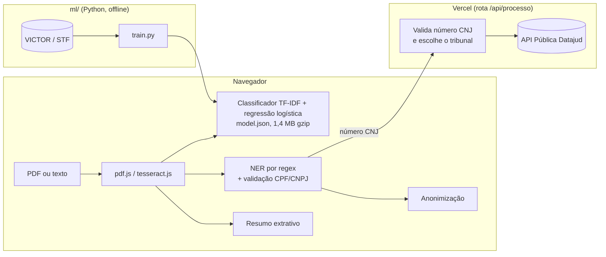

<p align="center"></p>

# S.A.P.O. – Sistema de Análise de Peças Offline

[](https://github.com/Caiorhcp/sapo-juridico/actions/workflows/ci.yml)

**Demo: https://sapo-juridico.vercel.app**

Classifica peças processuais, encontra dados pessoais (LGPD) e resume documentos jurídicos **dentro do navegador**. O PDF nunca sai do dispositivo: leitura, OCR, classificação, extração de entidades e anonimização rodam no cliente. O modelo foi treinado com páginas reais de processos do STF rotuladas por especialistas do tribunal.

Projeto de Iniciação Científica (PIC), UNINASSAU. Desenvolvimento: Caio R. · Orientação: Prof. Msc. Afonso Calábria.

## O que faz

- **Ficha do processo**: em um quadro só, o tipo da peça, o número e o tribunal (pelos segmentos do número CNJ), o resultado da decisão (procedente, provido, não admitido, extinto…, separando o dispositivo da peça das decisões apenas citadas), as partes por polo, os advogados com OAB, os valores rotulados (causa, danos morais, honorários…) e a linha do tempo.
- **Prazos com vencimento**: encontra prazos no texto ("no prazo de 15 (quinze) dias") e calcula o vencimento a partir da data de intimação, em dias úteis (CPC, arts. 219, 220 e 224), com feriados nacionais e recesso forense.
- **Triagem em lote**: vários PDFs de uma vez, numa tabela com tipo, resultado, processo e prazos; exporta planilha (CSV para Excel) e imprime ou salva o relatório em PDF.
- **Tipo de cada página**: Acórdão, Agravo em RE, Despacho, Petição de RE, Sentença ou Outros. Páginas seguidas do mesmo tipo viram uma peça (ex.: "pp. 1–2 · Petição de RE, p. 3 · Despacho").
- **Dados pessoais**: CPF e CNPJ validados pelo dígito verificador, e-mail, telefone, endereço, RG, CNH, PIS. Gera uma nota de exposição de 0 a 100 e baixa o **texto anonimizado** (`[CPF]`, `[EMAIL]`…).
- **Referências jurídicas**: número CNJ, leis, artigos, súmulas, tribunais, datas e valores.
- **Resumo extrativo**: frases mais centrais do texto (TF-IDF + similaridade), com peso maior para trechos de dispositivo e pedido.
- **PDF escaneado**: OCR automático em português com tesseract.js, servido pelo próprio site (sem CDN).
- **Consulta ao Datajud (CNJ)**: classe, assuntos, órgão julgador e **todas** as movimentações de cada instância, com marcos destacados (distribuição, audiência, decisão, recurso, trânsito em julgado, baixa), tempo de tramitação, alerta de processo parado há mais de 90 dias e exportação em CSV. É a única parte que usa servidor, e só o número do processo é enviado.
- **Funciona offline**: depois da primeira visita, um service worker guarda a página, o modelo e o OCR. O site abre e analisa documentos sem internet; só o Datajud precisa de conexão.

## Arquitetura



O modelo é treinado em Python e exportado como JSON (termos, IDF, pesos). A inferência foi reescrita em TypeScript puro, sem biblioteca de ML no navegador; um teste garante que as probabilidades do TypeScript são as mesmas do scikit-learn.

## Resultados

Conjunto de teste do **VICTOR Small** ([Luz de Araujo et al., LREC 2020](https://aclanthology.org/2020.lrec-1.181/)): 95.526 páginas de recursos extraordinários do STF, mesma divisão treino/validação/teste do artigo original, F1 por página.

| Modelo | F1 macro | F1 ponderado |
|---|---|---|
| **Este projeto**: TF-IDF uni+bigramas (30 mil termos) + regressão logística | **78,2** | **94,7** |
| SVM linear (artigo original) | 76,3 | 94,3 |
| CNN (artigo original) | 75,8 | 94,7 |

F1 por classe: Acórdão 88,4 · Sentença 81,1 · Petição de RE 74,6 · Despacho 71,2 · Agravo em RE 56,8 · Outros 97,4.

**Prior uniforme no site.** No VICTOR, 89% das páginas são "Outros" (certidões, procurações), porque cada processo é inteiro. No site, o usuário envia uma peça por vez, então a inferência divide pela frequência de cada classe no treino, o que equivale a supor classes igualmente prováveis. Isso troca F1 macro por recall:

| Cenário | Recall médio por classe | F1 macro |
|---|---|---|
| Distribuição do STF (benchmark) | 74,2 | 78,2 |
| Classes igualmente prováveis (site) | **86,8** | 57,6 |

Todos os números vêm de [`ml/metrics.json`](ml/metrics.json), gerado por `ml/train.py`.

## Decisões técnicas

- **Dataset real em vez de rótulos por fonte.** A versão 1 rotulava artigos de lei pela lei de origem (CLT virava "petição"), e o modelo aprendia a reconhecer a fonte, não o tipo de documento. A versão 2 usa o VICTOR, rotulado por especialistas do STF, e compara com o baseline publicado.
- **Regressão logística em vez de rede neural.** Bateu o SVM e a CNN do artigo, gera probabilidades calibradas e cabe em 1,4 MB. A versão 1 usava TensorFlow 2.15, que prendia o projeto ao Python 3.11.
- **Inferência no navegador.** A promessa de privacidade (LGPD) fica verdadeira no produto publicado: não existe servidor que receba o documento.
- **Datajud no servidor.** A API do CNJ exige chave e não aceita chamadas do navegador. A rota valida o dígito verificador do número CNJ (ISO 7064) e escolhe o índice pelo segmento de Justiça (Resolução CNJ 65/2008). Não há dados de exemplo: se a consulta falha, a tela diz o motivo.

## Como rodar

**Site** (Node 24):

```bash
cd web
npm install
echo "DATAJUD_API_KEY=<chave pública em datajud-wiki.cnj.jus.br/api-publica/acesso>" > .env.local
npm run dev        # http://localhost:3000
npm test           # 66 testes (Vitest)
```

**Treino** (Python 3.12 com [uv](https://docs.astral.sh/uv/)): baixe os três `.parquet` de [`Luciano/victor_lrec_2020_small`](https://huggingface.co/datasets/Luciano/victor_lrec_2020_small) para `data/victor/` (`train.parquet`, `validation.parquet`, `test.parquet`).

```bash
cd ml
uv run --python 3.12 python train.py   # ~6 min; gera web/public/model.json e ml/metrics.json
uv run --python 3.12 pytest
```

## Estrutura

```
ml/
  train.py           treino, avaliação, exportação do modelo e checagem de paridade
  metrics.json       métricas do conjunto de teste
web/
  src/app/           página, analisador, consulta ao Datajud e rota /api/processo
  src/lib/           classifier, ner, summarizer, pdf, cnj, datajud (+ testes)
  public/model.json  modelo exportado
```

## Limitações

- "Agravo em RE" é a classe mais difícil (F1 de 56,8): é confundida com petição de RE, como no artigo original.
- Uma página só com a qualificação das partes se parece com uma procuração e tende a sair como "Outros".
- O modelo conhece as peças típicas de um recurso extraordinário. Contratos, pareceres e documentos de outras áreas não fazem parte das classes.
- A análise de dados pessoais usa regras e não substitui uma avaliação jurídica de conformidade com a LGPD.
- Partes, resultado, valores e prazos vêm de regras sobre o texto: ajudam na triagem, mas precisam de conferência. O cálculo de prazo não inclui feriados estaduais e municipais nem regras especiais de intimação (art. 231 do CPC).
- O Datajud leva de 30 a 50 segundos por consulta, tem limite de requisições e não inclui o STF.

## Dados e licença

O código está sob a licença [MIT](LICENSE). O VICTOR é distribuído sob CC BY-NC (uso não comercial); por isso os dados não estão neste repositório. Cite o trabalho original:

> Luz de Araujo, P. H.; de Campos, T. E.; Braz, F. A.; da Silva, N. C. *VICTOR: a Dataset for Brazilian Legal Documents Classification*. LREC 2020, p. 1449–1458.

A versão 1 do projeto (Streamlit + TensorFlow Lite) está no histórico da branch `main`.
